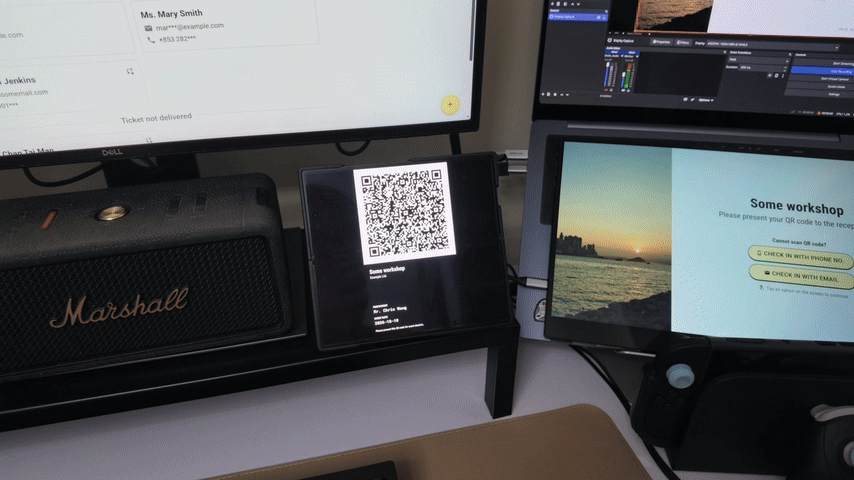
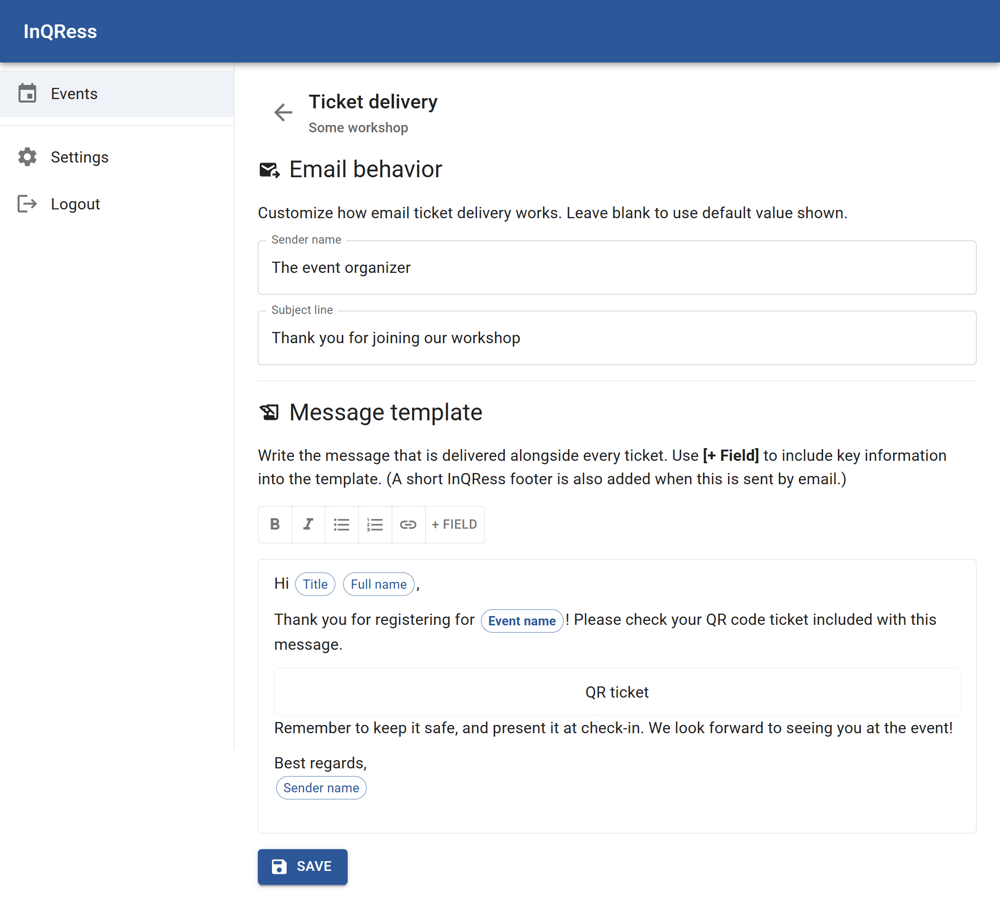
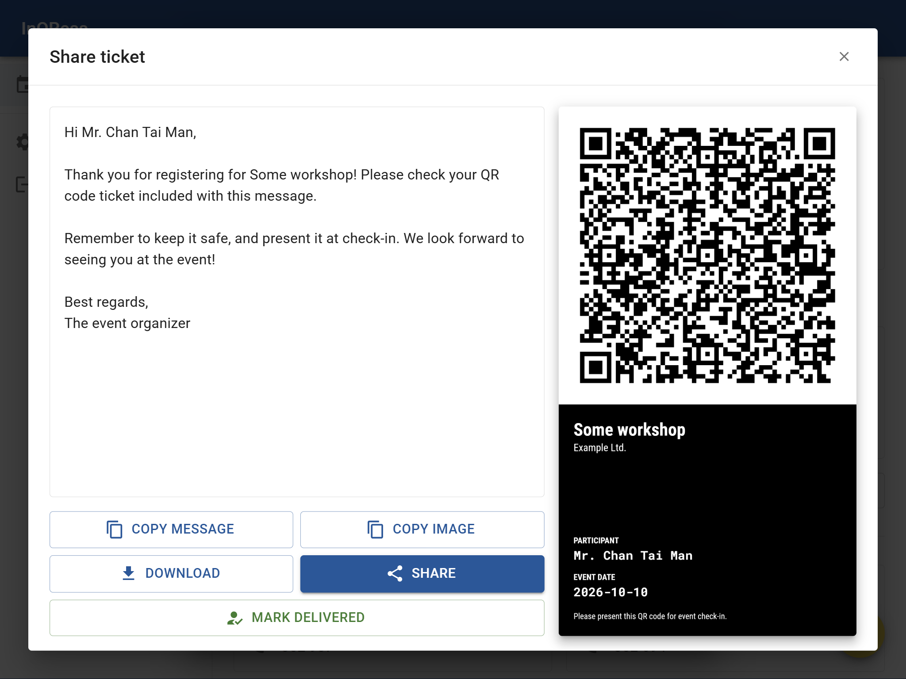

# InQRess

**Self-hosted QR check-in system.** A free alternative to paid ticketing services for small- to medium-sized events.

## Key Features ✨

InQRess is still the check-in system you know and love, with a massive grow-up in V2:

- **Just scan and they’re in:** Send your guests QR code tickets, and scan them when they arrive.
- **Multiple check-in methods:** QR ticket, phone/email on the kiosk, or manual confirmation with the guest.
- **Automatic guest import:** Sync participants data from the forms and spreadsheets you already use.
- **Send tickets by email or yourself:** Bulk ticket delivery by email, or you share it yourself, using customizable message templates.
- **Customizable kiosk:** Set custom images and accent color for the guest check-in kiosk.
- **Live attendance:** See who's arrived while the event is running.

### (Probably) the easiest way to check your guest in, now even faster in V2

Just scan and your guest is checked in. As simple as that.

QR check-in is now even faster and more convenient in V2. With the brand new **companion device pairing** feature, you can now **use your phone as the scanner** (because it’s already good at that) and have it wirelessly connect to InQRess, so you can move freely while you scan your guest’s ticket with improved accuracy and speed. Your guest will see they have checked in on the kiosk screen at your front desk.

### Alternative check-in methods also work, just in case

If your guests can’t show their tickets, they still have **multiple ways of checking in** without being locked out of the event.

Guests can check in on the touchscreen kiosk **with the phone number or email address** they’ve registered for the event.

Alternatively, a receptionist can search for the guest by name at the admin page, then ask the guest to **confirm at the kiosk screen**.

### Bring your guests into the events, now automatically in V2

InQRess can now automatically pull participants from the forms or spreadsheets you use to register your guests.

Just add them as a **data source** for your events, and configure how the spreadsheet columns map to participants' detail. InQRess will **synchronize and keep your participant list updated** every now and then.

And just because a guest has signed up doesn’t mean they’re automatically enrolled. You can also **configure participants (from a particular data source) to require your manual admission**, so only paid or approved guests can check in to your event.

Of course, the old-school way of importing guests via **manual spreadsheet upload** or **typing them** in is still there, just in case you need it:

### Send your guests tickets by email or yourself

Once your guests are registered and admitted, you can **send tickets to the guests by email**, all at once.

Of course, you have the creative freedom of how your email looks to your guest, with **customizable subject line** and **message template**.

If you want to share the ticket via a medium outside of email by yourself, V2 also added a new **"Share ticket" feature**, so you can conveniently send the ticket image together with the same message template:

### Make your front desk personal with customizable kiosk

You can **personalize the kiosk** by setting a custom image and a matching accent color to make it presentable for your event.

### See who’s arrived while it’s live

Once your event goes live, you can see the **real-time attendance** count as well as who’s already checked into your event.

## Quality-of-life Improvements in V2

### Enjoy InQRess on “every” device you own with Responsive UI

The InQRess admin pages are designed from the ground up to support [Responsive Web Design](https://developer.mozilla.org/en-US/docs/Learn_web_development/Core/CSS_layout/Responsive_Design). No matter if you’re managing your events on your phone, foldable, or laptop, the interface fits your screen so you can continue your work as you go.

### If you didn’t mean to do it, you can undo it

Whether you accidentally put your event in "live" mode while testing ticket scanning, or you accidentally mark a guest’s ticket as delivered, or even deactivate the guest's ticket after admission. You can now **undo it yourself**.

### Status bar and battery monitoring

On a connected kiosk or scanner, you can check the connectivity status (or the current time on a kiosk) at a glance through the **status bar**.

If the battery runs low on your connected device (below 25%), an **audible low battery warning** will also appear to remind you to keep them charged immediately.

> [!note]
>
> Battery status is only supported on Google Chrome or [certain Chromium-based browsers](https://developer.mozilla.org/en-US/docs/Web/API/Battery_Status_API#browser_compatibility).

## Your tickets are secure & tamper-proof, as always

With a **robust security mechanism** built in, only tickets you created can be used to check in at your events.

Every ticket is generated using [PASETO (Platform-Agnostic SEcurity TOkens)](https://paseto.io/), and you keep a unique pair of keys per event that you can sign the tickets with and verify later that the tickets are indeed created by you (of course, everything is done automatically inside InQRess!). A guest without your key will not be able to forge a ticket that can pass your ticket validation.

InQRess also reads live attendance records and participant status from your event, so the same ticket cannot be used twice, and you are still in full control of who can check in after the ticket is sent.

## Love the idea? Get InQRess on your computer / server

You’ll need Docker and network knowledge (and a bit of comfort with the terminal). For how to set it up on your own hardware as well as the device needed, see [setup guide](docs/setup.md).

## Tech stack

- **Frontend:** React, Vite, MUI
- **Backend:** Python, FastAPI, SQLite, PASETO
- **Deployment:** Docker + Caddy

---

**This project is at an early stage and is not thoroughly tested. To suggest a feature or report a bug, [open an issue](https://github.com/bench352/inqress/issues).*

**The image used in the customize kiosk example is shot by me, at [West Kowloon Cultral District, Hong Kong](https://maps.app.goo.gl/L9252v2z7kvh7SeYA).*

*All personal data in the illustrations is fictional and does not represent any real person.*
